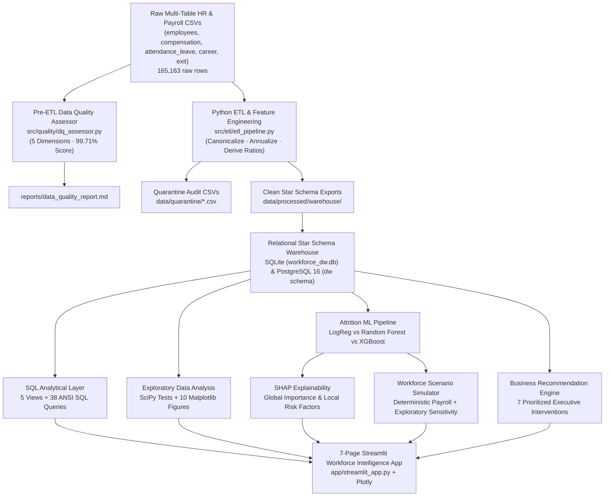
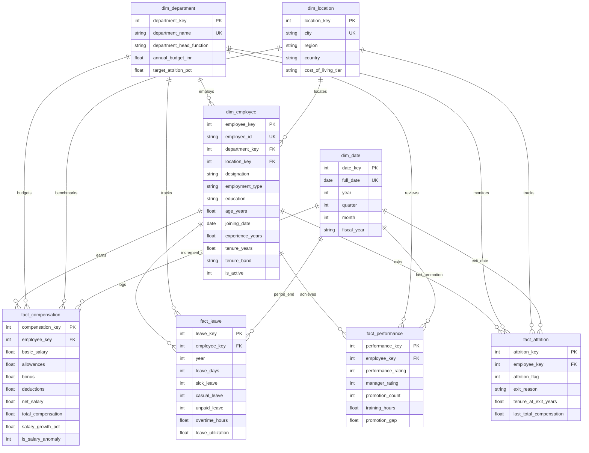
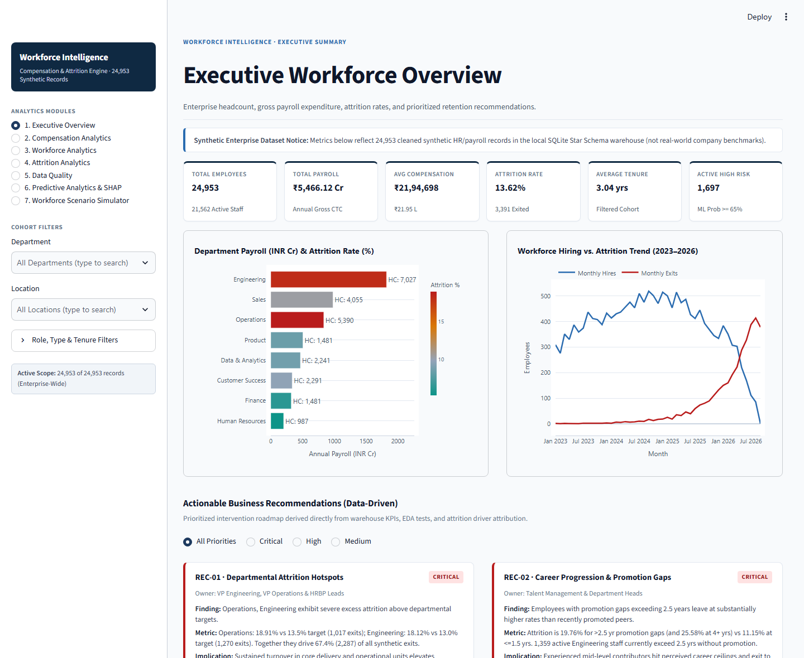
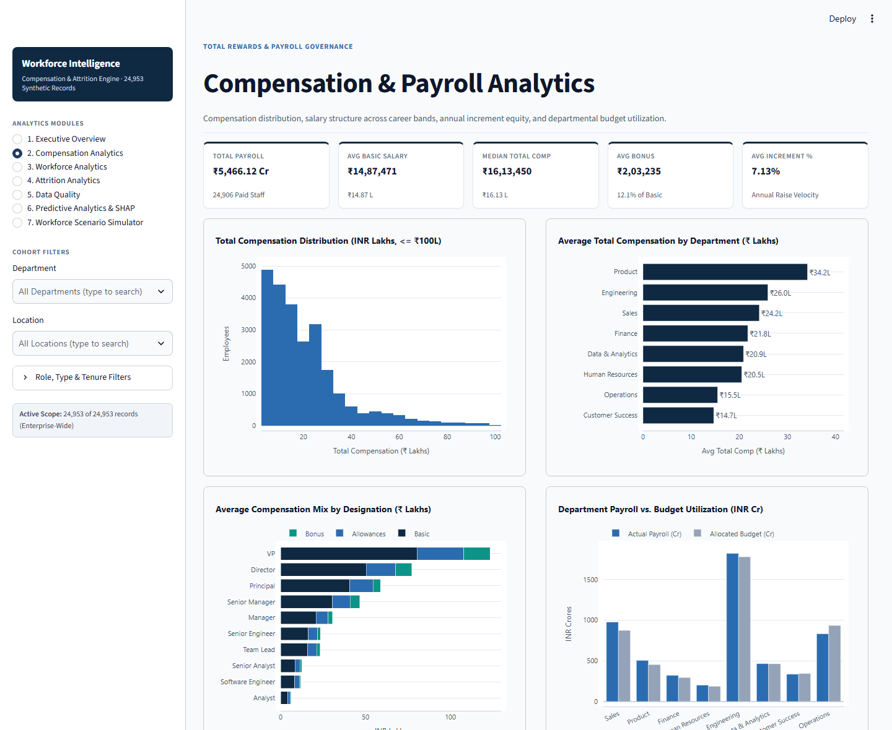
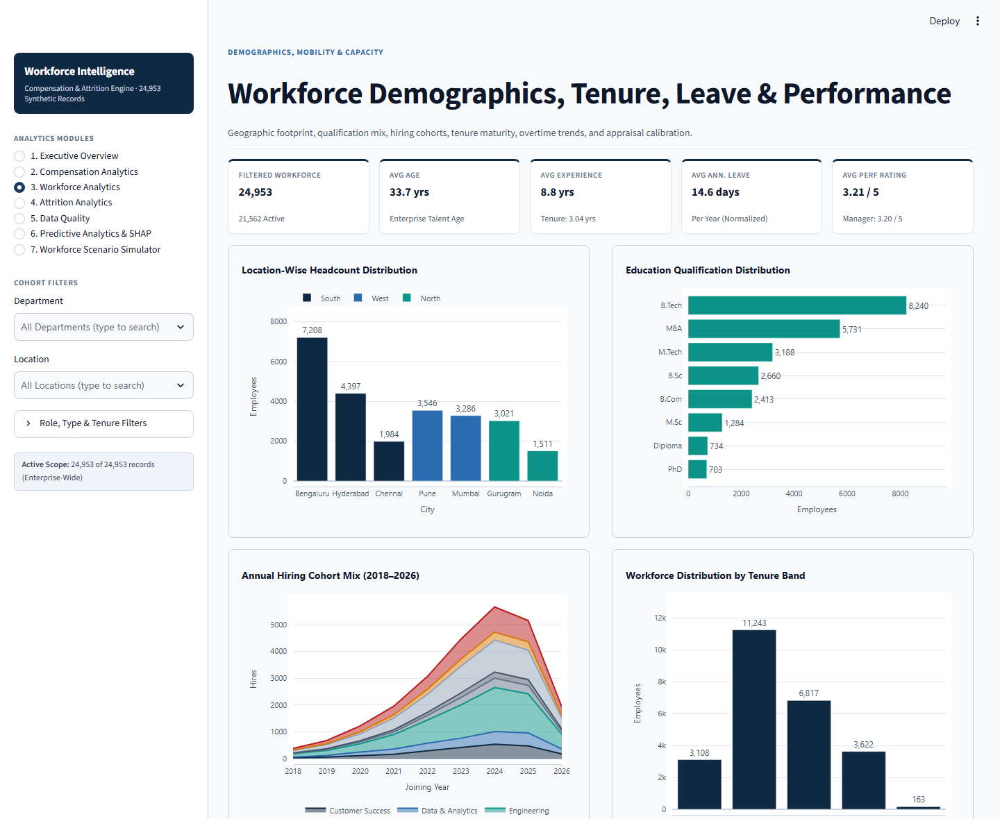
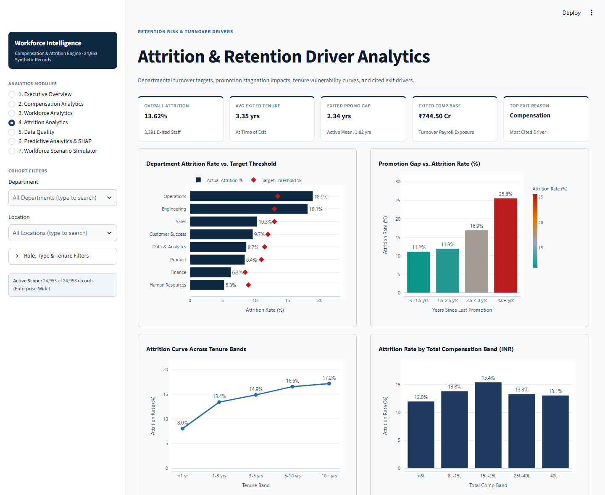
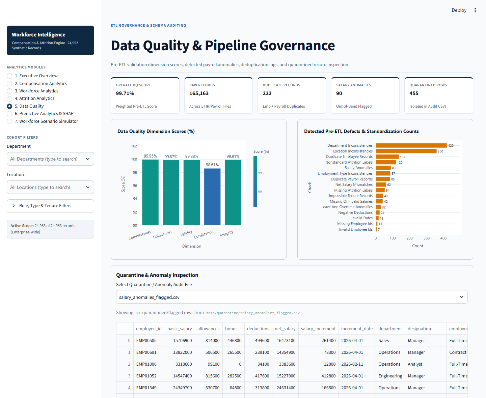
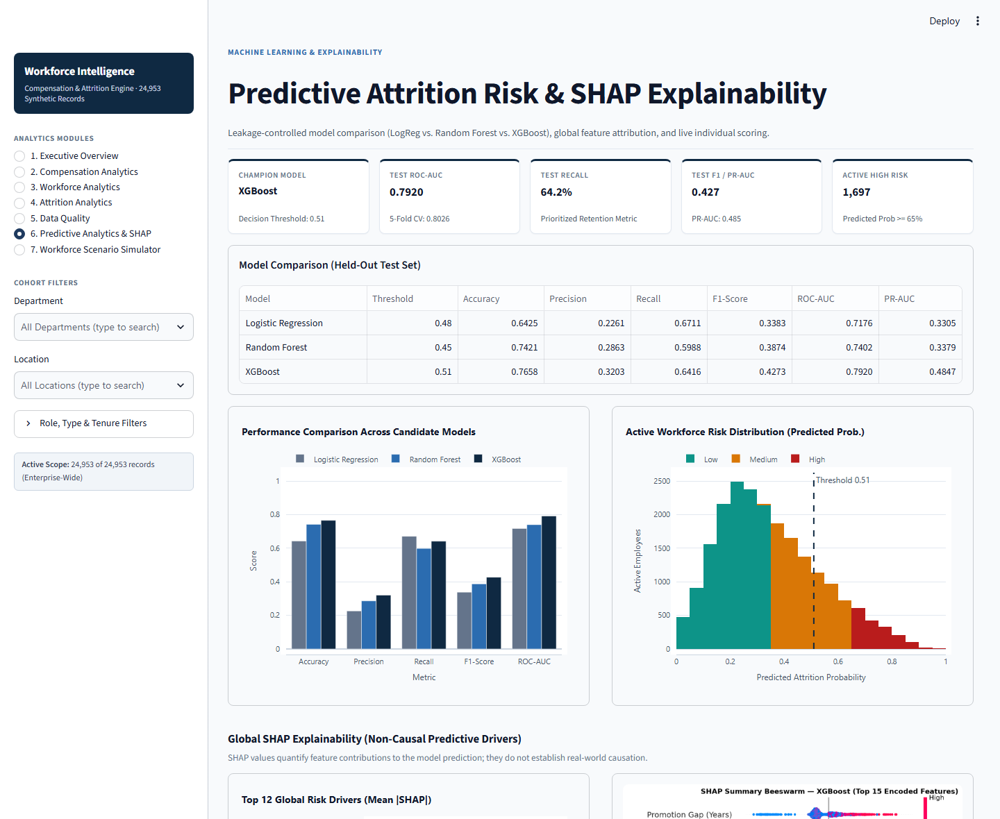
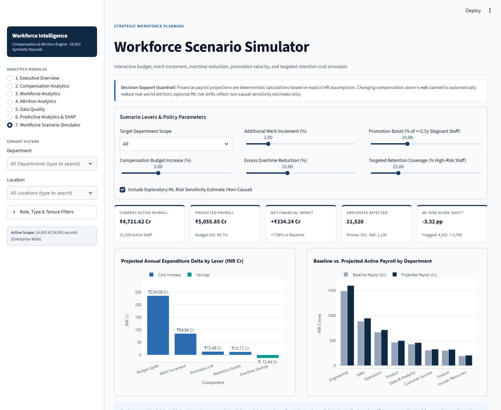
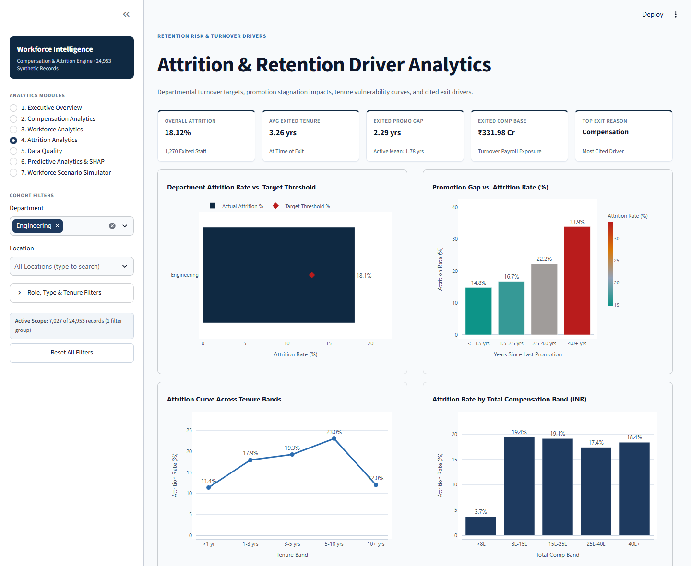

# Workforce & Compensation Analytics Engine

**Repository:** `workforce-compensation-analytics`  
**Stack:** Python 3.11+ · Pandas · SQLite / PostgreSQL 16 · SciPy · Scikit-learn · XGBoost · SHAP · Plotly · Streamlit · Pytest

An end-to-end enterprise HR, Payroll, and People Analytics decision-support system covering **Synthetic Enterprise Data Generation (25,000+ records)**, **Automated Pre-ETL Data Quality Auditing**, **Python ETL & Quarantine**, **Kimball Star Schema Warehousing (SQLite & PostgreSQL 16)**, **38 ANSI SQL Business Queries & 5 Views**, **Statistical Exploratory Data Analysis**, **Leakage-Controlled ML Attrition Modeling (Logistic Regression, Random Forest, XGBoost)**, **SHAP Explainability**, **Workforce Scenario Simulation**, **Automated Business Recommendations**, and a **7-Page Responsive Streamlit Application**.

> **Synthetic Dataset Disclaimer:** Every employee record, payroll total (`₹5,466.12 Cr`), attrition rate (`13.62%` overall), hypothesis test, and predictive risk score in this repository comes from a **synthetic enterprise HR/payroll dataset** built exclusively for analytical engineering and portfolio demonstration. These figures are **not** real-world company benchmarks.

---

## Executive Summary & Introduction

Enterprise People Analytics teams rarely fail due to a lack of charts—they fail when payroll exports, leave registers, appraisal ratings, and exit tables live in inconsistent spreadsheets without schema governance or decision linkage.

The **Workforce & Compensation Analytics Engine** models that full lifecycle cleanly:
1. Generates messy enterprise-scale multi-table HR & payroll inputs (`165,163` raw rows across 5 source tables with controlled defects).
2. Audits and quarantines anomalies *before* transformation (**`99.71%`** baseline Data Quality score; `455` quarantined/flagged anomalies).
3. Loads **`24,953` clean employees** into a relational **Star Schema Data Warehouse** (`4` dimensions, `4` facts, strict foreign-key integrity).
4. Computes reconciled KPIs across SQL views, statistical EDA, and an XGBoost attrition classifier (**`0.7920` Test ROC-AUC**, **`64.2%` Recall**), surfacing actionable insights inside an interactive executive application.

---

## Business Problem Statement & Project Objectives

### Problem Statement
Leadership lacks a single, audited analytics system to answer interrelated workforce questions:
- Which departments drive budget overruns versus unhealthy attrition against target thresholds?
- How strongly do promotion stagnation, lagging salary increments, and chronic overtime track employee exits?
- Which active high-performing employees sit in silent flight-risk pockets—and what deterministic payroll impact results from targeted policy interventions?

### Objectives
- Enforce **pre-warehouse Data Quality validation** with transparent quarantine logs instead of silent row dropping.
- Build a **normalized dimensional warehouse** executable both zero-config locally (**SQLite**) and containerized (**PostgreSQL 16**).
- Deliver **38 business-ready ANSI SQL queries** and **5 analytical views** using CTEs and window functions.
- Prevent **ML target leakage** and optimize predictive screening for retention utility (**Recall**, **ROC-AUC**, **PR-AUC**) with **SHAP** transparency.
- Separate **deterministic financial payroll calculations** from **non-causal exploratory ML sensitivity estimates** in an executive UI.

---

## Key Features

- **Data Quality Engine:** Evaluates 5 DQ dimensions (`Completeness`, `Uniqueness`, `Validity`, `Consistency`, `Temporal Integrity`) and isolates malformed records (`data/quarantine/*.csv`).
- **Modular Python ETL:** Canonicalizes `420` messy department strings, `360` location variants, and `62` net-pay mismatches; annualizes partial-year 2026 YTD leave/overtime metrics (`÷ 0.75`).
- **Dual-Backend Star Schema:** Identical relational DDLs and analytical views for SQLite (`workforce_dw.db`) and PostgreSQL 16 (`dw` schema via Docker Compose).
- **38 Executed SQL Queries:** Covers headcount, hiring cohorts, compa-ratios, below-average raises, budget utilization, turnover exposure, training impact, and overtime burnout.
- **Statistical EDA (`10` Figures):** SciPy chi-square and Pearson hypothesis tests backed by automated narrative reporting (`reports/eda_report.md`).
- **Leakage-Controlled ML + SHAP:** Compares Logistic Regression, Random Forest, and XGBoost (`scale_pos_weight=6.34`, OOF F1.5 recall calibration) plus `TreeExplainer` global and per-employee explanations.
- **Deterministic Scenario Simulator:** Models budget uplifts, merit increments, overtime reduction savings, promotion catch-ups, and retention grants across active staff (`21,520` compensated active employees).
- **Automated Business Recommendations:** Generates `7` prioritized action items linking finding, supporting metric, implication, and executive owner.
- **Enterprise 7-Page Dashboard + Tests:** Custom Navy/White/Slate responsive UI with searchable multi-select filters, backed by `12` automated `pytest` and Streamlit `AppTest` checks.

---

## Technology Stack

| Layer | Technologies |
|---|---|
| **Language & Config** | Python 3.11+ (`3.13.1` verified), `dataclasses`, `.env` configuration |
| **ETL & Data Processing** | `pandas`, `numpy`, `pyarrow` (Parquet/CSV) |
| **Data Warehousing & SQL** | `sqlite3` (default), PostgreSQL 16 (`psycopg2-binary`, Docker Compose) |
| **Statistics & Static Charts** | `scipy`, `matplotlib` |
| **ML & Explainability** | `scikit-learn`, `xgboost`, `shap`, `joblib` |
| **Web Application & Visuals** | `streamlit`, `plotly` |
| **Testing & QA** | `pytest`, `streamlit.testing.v1.AppTest` |

---

## System Architecture Diagram



---

## Data Pipeline & Quality Engineering

The Phase 1 ingestion pipeline processes 5 synthetic enterprise feeds generated with realistic anomalies (`165,163` total rows):

| Quality Check / Stage | Observed Result |
|---|---|
| Raw Employee Rows / Unique Valid IDs | `25,137` raw rows / `24,987` unique valid IDs |
| Cleaned Employees Loaded into Warehouse | **`24,953`** (`21,562` Active, `3,391` Exited) |
| **Overall Pre-ETL Data Quality Score** | **`99.71%`** |
| Quality Dimensions | Completeness `99.95%` · Uniqueness `99.87%` · Validity `99.88%` · Consistency `98.61%` · Temporal Integrity `99.91%` |
| Defects Caught & Standardized | `137` employee duplicates, `85` payroll duplicates, `11` missing IDs, `7` invalid IDs, `42` missing/invalid salaries, `90` salary anomalies, `420` dept aliases, `360` location aliases, `62` net-pay mismatches |

Engineered analytical columns include `tenure_years`, `salary_growth_pct`, `leave_utilization`, `overtime_ratio`, `promotion_gap`, `bonus_to_salary_ratio`, `total_compensation`, `tenure_band`, and `salary_band`. Partial-year 2026 attendance records (through `2026-09-30`) are normalized via `annualized_* = ytd_value / 0.75`.

---

## Dimensional Database Star Schema



---

## SQL Analytical Capabilities

- **5 Reusable Analytical Views** ([`sql/analytics/00_views_sqlite.sql`](sql/analytics/00_views_sqlite.sql) & [`00_views_postgres.sql`](sql/analytics/00_views_postgres.sql)): `vw_employee_workforce_360`, `vw_department_kpi_summary`, `vw_monthly_hiring_and_attrition`, `vw_high_risk_compensation_pockets`, `vw_data_quality_audit`.
- **38 ANSI SQL Queries** across 5 modules (`Q01`–`Q38`), utilizing `CTEs`, `RANK()`, `DENSE_RANK()`, `NTILE()`, `LAG()`, conditional `CASE`, and rolling aggregations.
- Full schema catalog and executed query outputs are documented in [`docs/sql_documentation.md`](docs/sql_documentation.md) and [`reports/sql_analytical_findings.md`](reports/sql_analytical_findings.md).

---

## Exploratory Data Analysis (EDA)

Running [`src/analytics/eda_analysis.py`](src/analytics/eda_analysis.py) generates `10` publication-ready plots (`reports/figures/01_*.png` through `10_*.png`) and `8` statistically tested findings in [`reports/eda_report.md`](reports/eda_report.md):

1. **Promotion Stagnation:** Attrition escalates from `11.15%` (`<=1.5 yrs` gap) to `19.76%` (`>2.5 yrs`) and `25.58%` (`4.0+ yrs`; Chi-square `= 259.7`, `p = 2.01e-58`).
2. **Department Attrition Hotspots:** Operations (`18.91%`) and Engineering (`18.12%`) exceed targets (`13.5%` / `13.0%`) and account for **`67.4%` (`2,287`) of all exits**.
3. **Overtime Burnout:** `250+` annualized overtime hours track **`28.08%`** attrition vs. `10.18%` for `<80 hrs` (Chi-square `= 584.0`, `p = 5.17e-129`).
4. **Salary Growth Lag:** `<4%` annual increments track `31.24%` attrition vs. `9.28%` for `8–12%` raises (Chi-square `= 807.6`, `p = 1.22e-177`).
5. **Pay-for-Performance & Manager Calibration:** Performance Rating correlates with raise % (`Pearson r = 0.678`), yet low manager ratings (`<=2`) elevate attrition across all tiers.
6. **Leave & Disengagement Signals:** Employees logging `3+` unpaid leave days show `30.93%` attrition vs. `10.97%` at `0` unpaid days.
7. **Tenure Profile:** `1–3 yrs` accounts for `44.4%` of absolute exit volume (`13.41%` rate), while `5–10 yrs` reaches the highest band attrition rate (`16.56%`) as promotion gaps accumulate.
8. **Payroll Concentration & Budget Overruns:** `6 of 8` departments exceed `100%` allocated budgets led by Sales (`111.8%`) and Product (`111.1%`), while Operations operates at `89.2%`.

---

## ML Attrition Prediction & Model Evaluation

- **Split & Validation:** `24,893` labeled employees split stratified `80% / 20%` (`19,914` train / `4,979` test), tuned via 3-fold `GridSearchCV` + 5-fold stratified OOF F1.5 recall threshold calibration.
- **Zero Target Leakage:** Strictly excludes `exit_date`, `exit_reason`, `is_active`, `tenure_at_exit_years`, and `latest_leave_year` (`test_no_leakage_in_features` verified).
- **Imbalance Handling:** `class_weight="balanced"` (Logistic Regression / Random Forest) and `scale_pos_weight=6.34` (XGBoost).

### Held-Out Test Set Performance (Recall-Optimized Thresholds)

| Model | Threshold | Accuracy | Precision | Recall | F1-Score | ROC-AUC | PR-AUC | 5-Fold CV ROC-AUC |
|---|---:|---:|---:|---:|---:|---:|---:|---:|
| Logistic Regression | `0.48` | `0.6425` | `0.2261` | **`0.6711`** | `0.3383` | `0.7176` | `0.3305` | `0.7314` |
| Random Forest | `0.45` | `0.7421` | `0.2863` | `0.5988` | `0.3874` | `0.7402` | `0.3379` | `0.7462` |
| **XGBoost (Champion)** | **`0.51`** | **`0.7658`** | **`0.3203`** | **`0.6416`** | **`0.4273`** | **`0.7920`** | **`0.4847`** | **`0.8026`** |

Champion (`XGBoost`, `max_depth=3`, `learning_rate=0.08`, `n_estimators=260`) confusion matrix at threshold `0.51`: `TN=3,378`, `FP=923`, `FN=243`, `TP=435`. Full curves live in [`reports/model_evaluation.md`](reports/model_evaluation.md).

---

## SHAP Explainability

Using `shap.TreeExplainer` (`n=2,000` sample), one-hot encoded contributions are aggregated back to domain features ([`reports/shap_explainability_report.md`](reports/shap_explainability_report.md)):

| Rank | Business Feature | Mean \|SHAP\| Contribution |
|---:|---|---:|
| 1 | `Promotion Gap (Years)` | `0.3380` |
| 2 | `Annualized Overtime Hours` | `0.2813` |
| 3 | `Salary Growth (%)` | `0.2796` |
| 4 | `Company Tenure (Years)` | `0.2740` |
| 5 | `Department` | `0.1817` |

> **Methodological Boundary:** SHAP values explain feature contributions to **predicted risk scores relative to model baseline**; they do **not** prove causal impact.

---

## Interactive Dashboard Preview (`1440px` Desktop Captures)

All screenshots below were captured directly from the live Streamlit dashboard at `1440px` desktop resolution:

| 1. Executive Overview | 2. Compensation Analytics |
|---|---|
|  |  |

| 3. Workforce Analytics | 4. Attrition Analytics |
|---|---|
|  |  |

| 5. Data Quality Governance | 6. Predictive Analytics & SHAP |
|---|---|
|  |  |

| 7. Workforce Scenario Simulator | Interactive Sidebar Filtering (`Engineering`) |
|---|---|
|  |  |

---

## Scenario Simulator & Business Recommendations

- **Workforce Scenario Simulator ([`src/simulator/scenario_engine.py`](src/simulator/scenario_engine.py)):** Models budget increases (`0–15%`), merit increments (`0–10%`), excess overtime reductions (`0–40%`), stagnant-employee promotion boosts (`0–30%`), and high-risk retention grants (`0–100%`). Financial delta (`₹ Cr`) is deterministic (`+₹334.24 Cr` / `94.7%` budget utilization under default baseline levers), while optional ML risk score shifts (`-3.32 pp`) are surfaced with a non-causal sensitivity disclaimer.
- **7 Data-Driven Recommendations ([`reports/business_recommendations.md`](reports/business_recommendations.md)):** Covers Operations/Engineering attrition sprints (`REC-01`), bi-annual promotion reviews (`REC-02`, `1,359` Engineering staff `>=2.5 yrs` unpromoted), Operations overtime capacity rebalancing (`REC-03`, `89.2%` budget headroom), pay-for-performance equity (`REC-04`, `1,055` under-indexed high performers), budget gates (`REC-05`), HRIS DQ controls (`REC-06`), and HRBP stay interviews (`REC-07`, `1,697` high-risk staff `>=65%` prob).

---

## Repository Structure

```text
workforce-compensation-analytics/
├── .env.example                    # Safe configuration template (no real credentials)
├── .gitignore                      # Excludes .env, caches, and ~40 MB reproducible raw/DB files
├── .streamlit/config.toml          # Enforced light enterprise theme tokens
├── docker-compose.yml              # Optional PostgreSQL 16 service definition
├── pyproject.toml                  # Project metadata & pytest path config
├── requirements.txt                # Audited, actually used Python dependencies
├── README.md
├── app/
│   ├── data_loader.py              # Cached SQLite/artifact loaders & INR formatters
│   └── streamlit_app.py            # 7-page responsive Workforce Intelligence dashboard
├── config/
│   └── settings.py                 # Centralized paths, HR taxonomies & env config
├── docs/
│   ├── sql_documentation.md        # Star schema & 38-query SQL catalog
│   ├── technical_architecture.md   # System architecture & engineering decisions
│   ├── project_demo_script.md      # 3-5 minute interview walkthrough script
│   └── resume_project_description.md
├── models/
│   ├── best_attrition_model.joblib # Saved XGBoost champion pipeline (309 KB)
│   ├── model_comparison.json       # Held-out & CV evaluation metrics
│   └── shap_global_importance.json # SHAP global & sample individual explanations
├── reports/
│   ├── *.md                        # DQ, SQL, EDA, Model Eval, SHAP & Recommendation reports
│   └── figures/                    # 15 Matplotlib & SHAP figures
├── screenshots/                    # 8 verified 1440px UI screenshots + index
├── scripts/
│   ├── run_phase1.py               # Reproducible Phase 1 (Generate -> DQ -> ETL -> DW)
│   └── run_phases_2_to_7.py        # Reproducible Phases 2-7 (SQL -> EDA -> ML -> SHAP -> Recs)
├── sql/
│   ├── warehouse/                  # SQLite & PostgreSQL 16 DDLs + verification queries
│   └── analytics/                  # 5 views + 38 analytical SQL queries
├── src/                            # Modular Python packages (data_gen, quality, etl, warehouse, analytics, ml, simulator, recommendations)
└── tests/
    ├── test_phase1_pipeline.py     # Phase 1 ETL, DQ & FK integrity tests
    └── test_phases_2_to_8.py       # SQL, ML/SHAP, Scenario math & Streamlit AppTest suite
```

---

## Installation, Reproducible Setup & Execution (Windows / Cross-Platform)

1. **Clone the repository** and enter the project directory:
   ```powershell
   git clone https://github.com/neha-shet/workforce-compensation-analytics.git
   cd workforce-compensation-analytics
   ```
2. **Create and activate a Python 3.11+ virtual environment** (`Python 3.13.1` verified):
   ```powershell
   python -m venv .venv
   .\.venv\Scripts\Activate.ps1
   ```
3. **Install dependencies:**
   ```powershell
   pip install -r requirements.txt
   ```
4. **Optional environment configuration:**  
   SQLite mode (`DB_BACKEND=sqlite`) works out of the box with **zero `.env` required**. Only copy `.env.example` to `.env` and set a strong `PG_PASSWORD` if running PostgreSQL 16 via `docker compose up -d`.
5. **Generate synthetic dataset, clean via ETL, and build the SQLite warehouse:**
   ```powershell
   python scripts/run_phase1.py --employees 25000 --backend sqlite
   ```
6. **Run SQL analytics, EDA, ML training, SHAP, and recommendations** *(rebuilds warehouse artifacts & reports locally)*:
   ```powershell
   python scripts/run_phases_2_to_7.py
   ```
7. **Launch the interactive Streamlit application:**
   ```powershell
   streamlit run app/streamlit_app.py
   ```

---

## Testing Instructions

Run the complete `12`-test verification suite *(after running setup Steps 5–6 above to populate the local SQLite warehouse)* covering Phase 1 ETL/DQ/FK checks, 38 SQL views/queries, isolated ML/SHAP end-to-end training & leakage assertions, Scenario calculations, and Streamlit `AppTest` navigation/filter interactions:

```powershell
pytest -v
```

*(Quick smoke checks also run individually via `python -m src.analytics.sql_runner` and `sqlite3` / `sql/warehouse/03_verify_warehouse.sql`.)*

---

## Limitations & Future Enhancements

### Limitations
- **Synthetic Behavioral Data:** Correlations, compensation distributions, and `13.62%` attrition are realistic analytical simulations rather than empirical company records.
- **2026 Partial-Year Attendance Normalization:** YTD attendance data through `2026-09-30` relies on linear annualization (`÷ 0.75`), which assumes even accrual across Q4.
- **Non-Causal Decision Modeling:** Neither ML feature weights nor SHAP values establish causation; Scenario Simulator retention shifts remain exploratory hypotheses requiring A/B HR pilot testing.

### Future Enhancements
- Connect real anonymized Workday / SAP SuccessFactors HRIS connectors via scheduled Airbyte / Airflow DAGs.
- Add longitudinal monthly snapshot SCD Type-2 history tracking (`dim_employee_history`) for promotion velocity survival analysis.
- Incorporate calibration confidence intervals around survival curves and budget Monte Carlo bounds in the Scenario Simulator.
