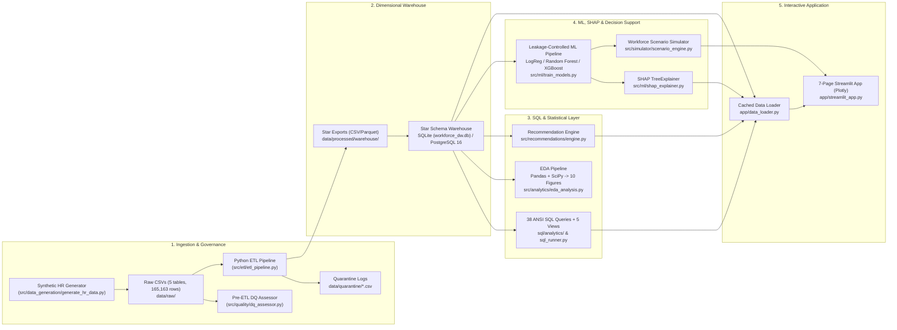

# Technical Architecture — Workforce & Compensation Analytics Engine

> **Scope & Data Boundary:** All quantitative examples below describe the verified Phase 1 synthetic dataset (`24,953` clean employees from `25,137` raw employee records, `165,163` total raw records across 5 tables) stored in SQLite (`data/warehouse/workforce_dw.db`) and mirrored for PostgreSQL 16 (`dw` schema).

---

## 1. End-to-End System Architecture

The platform is organized as a modular, configuration-driven analytical pipeline where every stage reads reproducible warehouse inputs and produces versioned artifacts:

---

## 2. Layered Module Responsibilities & Design Decisions

### Layer 1: Configuration (`config/settings.py`)
- Centralizes paths (`PATHS`), synthetic generation parameters (`NUM_EMPLOYEES=25000`, `RANDOM_SEED=42`, `AS_OF_DATE=2026-09-30`), canonical master taxonomies (`CANONICAL_DEPARTMENTS`, `CANONICAL_LOCATIONS`, `DESIGNATION_SALARY_BANDS_INR`), alias standardization lookup maps, and optional environment configuration (`.env` parsed without external dependency overhead).
- Keeps PostgreSQL credentials empty by default (`PG_PASSWORD=""`) and requires explicit environment provisioning when targeting PostgreSQL 16 (`load_postgres_warehouse`).

### Layer 2: Pre-ETL Data Quality & Cleaning (`src/quality/`, `src/etl/`)
- **Why validate before transforming?** Measuring defects *before* ETL cleaning ensures auditability:
  - Baseline Data Quality Score: **99.71%** weighted across **Completeness (99.95%)**, **Uniqueness (99.87%)**, **Validity (99.88%)**, **Consistency (98.61%)**, and **Temporal Integrity (99.91%)**.
  - Explicitly quarantines irremediable rows (`data/quarantine/*.csv`, `455` quarantined/flagged rows across duplicate employee IDs, invalid IDs/dates, impossible tenures, and out-of-band salary anomalies) while repairing deterministic inconsistencies (`420` messy department strings, `360` location variants, `62` net salary arithmetic mismatches).
- **Derived Analytical Features:** Computes `tenure_years`, `salary_growth_pct`, `leave_utilization`, `overtime_ratio`, `promotion_gap`, `bonus_to_salary_ratio`, `total_compensation`, `tenure_band`, and `salary_band`.
- **Annualization Normalization:** Because `2026` attendance data spans 9 months through `2026-09-30` (YTD factor `0.75`), ETL/warehouse views expose both raw leave/overtime and normalized annualized values (`÷ 0.75` for 2026) so year-over-year burnout trends remain statistically comparable.

### Layer 3: Dimensional Star Schema Warehouse (`sql/warehouse/`, `src/warehouse/`)
- Modeled as a classic Kimball star schema with 4 conformed dimensions and 4 fact tables plus an audit metadata table:
  - **Dimensions:** `dim_employee`, `dim_department`, `dim_location`, `dim_date`
  - **Facts:** `fact_compensation`, `fact_leave`, `fact_performance`, `fact_attrition`
  - **Metadata:** `meta_data_quality_metrics`
- **Dual-Engine SQL Parity:** DDL (`01_ddl_postgres.sql`, `02_ddl_sqlite.sql`) and views (`00_views_postgres.sql`, `00_views_sqlite.sql`) enforce strict foreign keys (`PRAGMA foreign_keys = ON` in SQLite; PostgreSQL schema constraints) and expose identical business logic (`vw_employee_workforce_360`, `vw_department_kpi_summary`, `vw_monthly_hiring_and_attrition`, `vw_high_risk_compensation_pockets`, `vw_data_quality_audit`).
- **Zero-Infra Default + Containerized Option:** Uses local SQLite (`data/warehouse/workforce_dw.db`) by default for frictionless reviewer setup while supporting `docker compose up -d` for PostgreSQL 16 bulk loading via `psycopg2.extras.execute_values`.

### Layer 4: SQL Analytical & EDA Layers (`sql/analytics/`, `src/analytics/`)
- `sql_runner.py` parses structured SQL query headers (`-- QUERY_ID: Qxx | ...`) across 5 themed `.sql` files (`38` queries total) using CTEs, `RANK()`, `DENSE_RANK()`, `NTILE()`, `LAG()`, conditional `CASE`, and multi-table joins.
- `eda_analysis.py` validates hypotheses programmatically with SciPy (`chi2_contingency`, `pearsonr`) and saves `10` publication-ready Matplotlib charts and structured Markdown/JSON findings (`reports/eda_report.md`).

### Layer 5: Leakage-Controlled ML & SHAP (`src/ml/`)
- **Strict Target-Leakage Prevention:** Explicitly enforces `FORBIDDEN_LEAKAGE_COLUMNS` (`exit_date`, `exit_reason`, `is_active`, `tenure_at_exit_years`, `latest_leave_year`, target columns, identifiers). Automated tests in `tests/test_phases_2_to_8.py` assert empty intersection with `FEATURE_COLUMNS`.
- **Imbalance & Metric Selection:** Compares Logistic Regression (`class_weight="balanced"`), Random Forest (`class_weight="balanced"`), and XGBoost (`scale_pos_weight=6.34`) on a stratified 80/20 split (`19,914` / `4,979` records).
  - Optimizing strictly for Accuracy is avoided under `13.62%` positive class prevalence; thresholds are calibrated on 5-fold out-of-fold probabilities to prioritize **Recall** and **ROC-AUC / PR-AUC**.
  - **Champion (`XGBoost`):** `0.7920` Test ROC-AUC (`0.8026` 5-fold CV), `0.6416` Recall, `0.4847` PR-AUC at threshold `0.51`.
- **Explainability Boundary:** `shap.TreeExplainer` computes Shapley values on transformed features, then aggregates one-hot encoded categorical attributions back to clean business domains (`Promotion Gap`, `Annualized Overtime`, `Salary Growth %`, `Company Tenure`, `Department`). Reports explicitly note SHAP shows predictive attribution, not causation.

### Layer 6: Decision Support — Scenario Simulator & Recommendation Engine (`src/simulator/`, `src/recommendations/`)
- **Deterministic Payroll Math:** `simulate_workforce_scenario` computes exact incremental expenditure (`Budget Uplift + Merit Increment + Promotion Lift + Retention Grants - Overtime Savings`) at employee granularity and aggregates by department budget.
- **Bounded ML Sensitivity:** Optional risk score shift re-scores modified feature vectors *strictly* labeled as exploratory non-causal sensitivity estimates.
- **Dynamic Recommendation Engine:** Evaluates warehouse KPIs, EDA tests, and SHAP summaries programmatically to emit `7` structured recommendations (`Finding`, `Supporting Metric`, `Business Implication`, `Recommended Action`, `Owner`, `Priority`).

### Layer 7: Enterprise Streamlit Application (`app/data_loader.py`, `app/streamlit_app.py`)
- **Responsive Enterprise UI:** Custom Navy/White/Slate CSS (`#0F2942`, `#1E3A5F`, `#2B6CB0`, `#F8FAFC`), explicit `base = "light"` `.streamlit/config.toml`, equal-height responsive KPI grid (`kpi-grid-6`, `kpi-grid`, `kpi-grid-3`), compact searchable multiselect sidebar filters (`empty = All`), lazy loading of ML/SHAP modules, `@st.cache_data` / `@st.cache_resource` caching, and `AppTest` UI verification.

---

## 3. Verification Strategy & Guardrails

| Verification Layer | Implementation |
|---|---|
| Schema & ETL Integrity | `tests/test_phase1_pipeline.py` verifies raw generation anomalies, quarantine isolation, clean uniqueness, and SQLite FK constraints. |
| SQL, ML, SHAP, Scenario Math | `tests/test_phases_2_to_8.py` tests all 5 views + 38 queries (`>0 rows`), end-to-end subset ML+SHAP training, zero leakage overlap, zero-delta & `+5%` scenario identities, and bare-mode rendering of all 7 pages. |
| Interactive Dashboard (`AppTest` + Chromium) | `test_streamlit_all_7_pages_render_without_exception` exercises all 7 pages, multiselect department filters, and `Reset All Filters`. |

